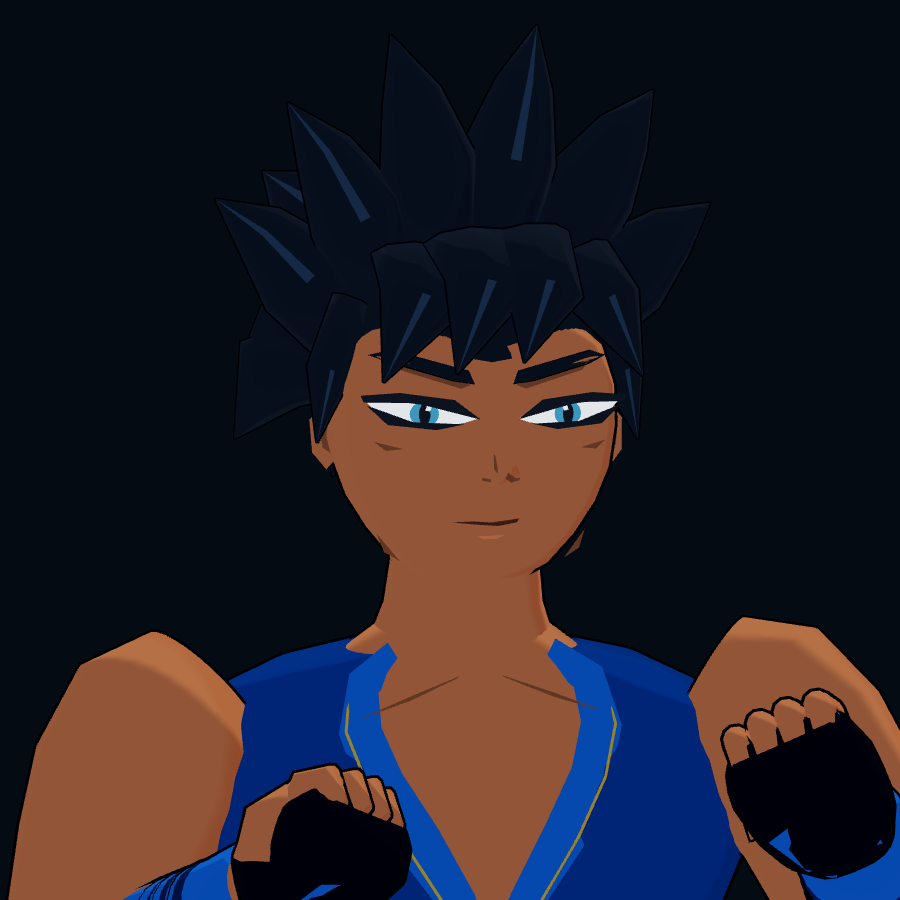
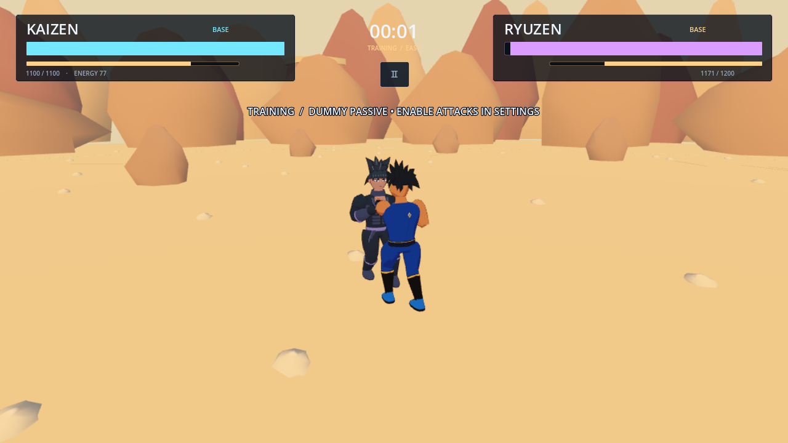

# Kaizen — Phase 1 visual review

Completed on 2026-10-29 with Godot 4.6.3 and Blender 4.3.2. This is a focused
Kaizen source update, stopping before any other roster work. The downloadable
0.2.0 APK and Windows ZIP still contain the previous art; they were not rebuilt
or replaced during this phase.

## What changed

- Replaced Kaizen's authored mesh surfaces with a tapered chest/waist,
  more defined shoulder/forearm sections and gathered trouser contours.
- Rebuilt the blue gi with an actual open V, shaped lapels, fold ridges,
  wrapped sash/knot/tails, back seam and original celestial crest.
- Added glove palms, four curled-finger shapes, thumbs, wrist wraps and shaped
  boots with separate sole, shin panel, cuff and lacing detail.
- Revised cheek/jaw/chin planes, nose, eyes, brows and mouth. Layered eye
  surfaces use explicit depth ordering to avoid the overlap caught in review.
- Replaced repetitive crown spikes with asymmetric swept, ridged hair clumps.
- Added a Kaizen-only toon shader with tinted shadows, stable ink/eye colour,
  restrained hair edge light and thinner outlines. Existing form colours work.
- Enlarged Kaizen's menu framing slightly. Close Kaizen fights use a modestly
  lower/wider shoulder camera; the change fades out by 8 metres of separation.
  Wide-distance aerial framing is retained.

The asset has **7,819 authored vertices / 13,957 triangles / 14 material
surfaces**, one skinned mesh, the same **18 bones** and the same **25 animation
clips**. Runtime LOD generation and quality settings remain enabled. The
editable `.blend`, exported `.glb` and isolated `kaizen_body.py` /
`kaizen_head.py` authoring modules are included.

Ryuzen/Akira GLBs, Blender sources and metadata are unchanged. Combat, input,
AI, countdown, damage and match systems were preserved. No new game modes or
later-phase features were started.

## Rendered evidence

These are actual **Godot OpenGL viewport captures**, not generated concept art
or offline Blender pictures. `before_*` shows baseline commit `d882439`.

| Capture | Before | After |
| --- | --- | --- |
| Normal menu, 1280×720 | [Menu before](review/phase1_kaizen/before_menu.png) | [Menu after](review/phase1_kaizen/after_menu.png) |
| Face/upper body, 900×900 | [Close-up before](review/phase1_kaizen/before_closeup.png) | [Close-up after](review/phase1_kaizen/after_closeup.png) |
| Normal battle camera, 1280×720 | [Battle before](review/phase1_kaizen/before_battle.png) | [Battle after](review/phase1_kaizen/after_battle.png) |

The close-up uses the **same live menu asset/materials/lights**, with its camera
reframed for inspection. The normal battle capture uses the shipped combat
camera during a real light attack (state time 0.1667 seconds), after the normal
countdown. An additional [three-quarter arena inspection](review/phase1_kaizen/after_battle_threequarter.png)
uses an explicitly staged camera to show the front of the outfit. Its camera
angle differs from `before_battle_threequarter.png`; those two shots should not
be treated as an identical-camera comparison.





## Verification

The regenerated GLB was imported by Godot successfully; its imported source
checksum matches the exported GLB. Python authoring modules compile and
`git diff --check` passes. The Blender exporter reports an unavailable optional
Draco library; these assets export without Draco compression and load normally.

`./tools/check.sh` exited 0 after the final asset and camera changes:

```text
COMBAT TESTS: 84/84 passed
ENERGY_TESTS: 27/27 checks passed
UI_TESTS: 71 checks, 0 failures
GAME TESTS: 81/81 passed
ANIMATION TESTS: 51/51 passed
All Godot regression suites passed.
```

The focused graphical harness also exited 0:

```text
KAIZEN PHASE1 RENDER CHECK: passed, failures=0
```

It loads the live menu and match scene, verifies the protected three-second
countdown, passive training opponent, movement through the normal keyboard
controller, accepted melee input and actual damage to the opponent. It saves
the screenshots above. The final run has no script errors or leaked-instance
warnings. Xorg's software driver reports that it cannot change V-Sync mode.

Reproduce on a graphical Linux session (use your actual display in `DISPLAY`):

```sh
XDG_DATA_HOME=/tmp/astral-kaizen-review/data \
XDG_CONFIG_HOME=/tmp/astral-kaizen-review/config \
XDG_CACHE_HOME=/tmp/astral-kaizen-review/cache \
ASTRAL_REVIEW_PREFIX=after DISPLAY=:99 \
godot --path . --rendering-method gl_compatibility --audio-driver Dummy \
  --fixed-fps 60 --script res://tests/render_kaizen_phase1.gd
```

The harness rejects headless mode. Rendering ran on Linux Xorg / Mesa llvmpipe
OpenGL 4.5 Compatibility. The countdown continues rendering at a smaller window
size for this software-rendered fixture; all saved captures and active input
checks use the full viewport. This is not physical Windows/Android testing or
a mobile performance measurement. Dummy audio does not verify speaker output.

Open `project.godot` in Godot 4.6.3, let imports finish and press F5 to play the
updated source. No Blender installation is needed to play it.

## Honest visual assessment

Kaizen is genuinely improved over the baseline: the hair silhouette is less
repetitive, eyes/face are sharper, fists have readable fingers/gloves, the chest
opening is coherent, and the outfit/boots have useful detail. The character
still has **prototype-quality art**, not a finished commercial anime model.

Broad anatomy/cloth forms, the neck/shoulder transition and some faceted hair
surfaces remain weak. Fingers are rigid to each hand bone rather than
individually rigged. Facial features have no blend-shape acting. The static
close-up does not establish polished motion, mobile frame rate or production
art quality. More sculpting, deformation refinement and animation work remain;
none of those are represented as completed here.
